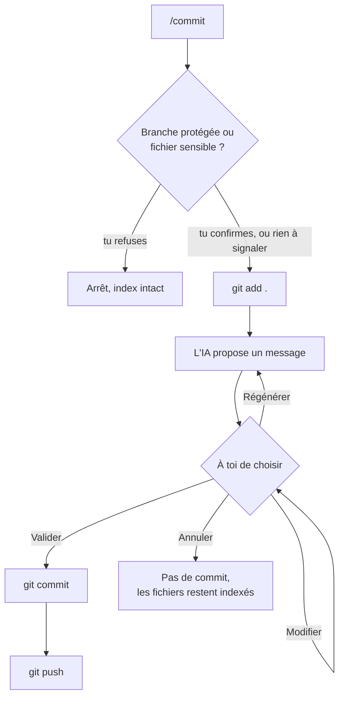

# 🧭 gitpilot

Ton copilote Git dans le terminal. Tu tapes `/commit`, l'IA propose le message, tu valides, et c'est poussé.

Chaque commande Git lancée pour toi s'affiche en gris. Tu vois donc toujours ce qui se passe, et tu apprends au passage. 👀

## ✨ Ce que ça t'apporte

- 🤖 Des messages de commit générés à partir de ton diff, avec Groq, Gemini ou Ollama.
- ⌨️ Une autocomplétion des commandes et des noms de branches.
- 🌳 Un graphe des commits dans ton navigateur, avec `/log`.
- 🚑 Des raccourcis `/hotfix` et `/fix` qui créent la branche depuis la bonne base.
- 🧩 Une résolution guidée des conflits pendant un rebase ou un cherry-pick.
- 🛟 Des garde-fous contre les erreurs qui font mal, comme committer un `.env` sans le voir.

## 🚀 Démarrage rapide

Il te faut Node.js 22.12 ou plus récent, `git` et Yarn.

```bash
git clone <url-de-ton-depot> gitpilot
cd gitpilot
yarn install
yarn build
mkdir -p ~/.local/bin
ln -s "$PWD/bin/gitpilot.js" ~/.local/bin/gitpilot
```

Ensuite, va dans n'importe quel dépôt et lance :

```bash
gitpilot
```

> [!NOTE]
> `push` et `pull` ne peuvent pas demander de mot de passe dans l'interface. Configure un credential helper ou charge ta clé dans `ssh-agent` avant de commencer.

## 🎮 Comment ça marche

gitpilot ouvre une petite interface dans ton terminal. L'en-tête affiche ta branche et tes fichiers en cours, mis à jour chaque seconde :

```text
gitpilot mon-projet main (+3, -2, +3)
```

Dans l'ordre : 🟢 fichiers ajoutés, 🔴 fichiers supprimés, 🟠 fichiers modifiés. Juste en dessous, tu tapes tes commandes.

| Touche | Effet |
| --- | --- |
| `/` | Ouvre la liste des commandes |
| ↑ ↓ | Choisissent dans la liste |
| Tab | Complète |
| Entrée | Valide |
| Échap | Ferme la liste |
| ↑ (liste fermée) | Remonte l'historique |

### 📝 Ce qui se passe quand tu lances `/commit`



Rien n'est committé sans ton accord. Si tu écris `/commit "ton message"`, gitpilot saute l'IA et utilise ton texte.

> [!TIP]
> Par défaut, `/commit` indexe tout et pousse tout de suite. Tu préfères garder la main ? Lance `/config set commit.addAll false` ou `/config set commit.autoPush false`.

### 🚑 Ce qui se passe avec `/hotfix` et `/fix`

1. gitpilot vérifie le nom de la branche et sa base, avant de toucher à quoi que ce soit.
2. Il committe ton travail en cours, avec le même flux que `/commit`.
3. Il crée la branche : `hotfix/<nom>` depuis `develop`, ou `fix/<nom>` depuis `preprod`.

Tes branches s'appellent autrement ? Change-les avec `/config set branches.develop dev`.

### 🧩 Ce qui se passe en cas de conflit

Pendant `/rebase` ou `/cherry-pick`, gitpilot liste les fichiers en conflit et attend. Tu les corriges dans ton éditeur, puis tu choisis : continuer, tout annuler (`--abort`) ou passer ce commit (`--skip`). Si tu choisis de continuer alors qu'il reste des conflits, il te dit lesquels.

### 🎉 Ce qui se passe avec `/first-push`

Tu viens de créer ton dépôt sur GitHub avec un README ou une LICENSE, et ton `git push` se fait rejeter avec `fetch first` ? C'est le cas classique : GitHub a son propre premier commit, et le tien n'a aucun lien avec lui. `/first-push` règle ça en une commande :

1. Il récupère ce qu'il y a sur `origin`.
2. Si tu as des modifications en cours, il te propose de les committer ou de les mettre de côté.
3. Il replace tes commits par-dessus ceux du dépôt distant. En cas de conflit, tu retrouves la résolution guidée.
4. Il pousse et relie ta branche, pour que `/push` suffise ensuite.

Il ne force jamais le push, donc les fichiers créés sur GitHub restent en place. Si la branche est déjà reliée au remote, il s'arrête et te renvoie vers `/push`.

## 🤖 Les messages générés par l'IA

gitpilot essaie `ai.provider`, puis les providers de `ai.fallbackOrder`. Il passe au suivant après 15 secondes, ou si le quota est dépassé ou la clé absente. Le dernier recours, `fallback`, construit un message à partir de la liste des fichiers. L'IA ne bloque donc jamais un commit.

Tes clés restent dans ton environnement. La configuration ne contient que le nom des variables. 🔑

### ⚡ Groq (gratuit)

1. Crée une clé sur <https://console.groq.com/keys>.
2. Ajoute à ton `~/.bashrc` : `export GROQ_API_KEY="..."`

### 💎 Gemini (palier gratuit)

1. Crée une clé sur <https://aistudio.google.com/apikey>.
2. Ajoute à ton `~/.bashrc` : `export GEMINI_API_KEY="..."`

### 🦙 Ollama (local)

```bash
ollama pull qwen2.5-coder
```

Le serveur doit tourner sur `http://localhost:11434`. Avec Ollama, ton diff ne quitte pas ta machine.

### 🔒 Ce qui est envoyé

Le provider reçoit la liste des fichiers et le diff indexé, tronqué à 12 000 caractères. Le contenu des fichiers `.env*`, `*.pem`, `*.key` et `id_rsa*` n'est jamais envoyé, seul leur nom l'est. Et gitpilot te demande confirmation avant de committer un de ces fichiers.

## ⚙️ Configuration

Le fichier global `~/.gitpilot/config.json` est créé au premier lancement. Un `.gitpilot.json` à la racine d'un dépôt peut en remplacer une partie.

Pour qu'un dépôt cloné ne puisse pas détourner tes diffs, `apiKeyEnv` et `baseUrl` ne sont acceptés que dans le fichier global.

```text
/config                                 affiche la configuration effective
/config set commit.autoPush false       modifie le fichier global
/config set --repo branches.develop dev modifie .gitpilot.json
/config edit                            ouvre le fichier dans $VISUAL ou $EDITOR
```

Les modèles par défaut changent vite chez les fournisseurs. Si un provider répond `HTTP 404`, change son modèle : `/config set ai.groq.model <modèle>`.

La page `/help` documente chaque option.

## 📚 Toutes les commandes

| Commande | Alias | Rôle |
| --- | --- | --- |
| `/init` | | Initialise un dépôt Git dans le dossier demandé (dossier courant par défaut) et le relie au dépôt distant indiqué |
| `/commit ["message"]` | `/cm` | Indexe, génère le message, committe, pousse |
| `/amend ["message"]` | | Modifie le dernier commit non poussé |
| `/undo` | | Annule le dernier commit non poussé, garde ses modifications |
| `/status` | `/s` | État du dépôt |
| `/diff` | | Résumé des changements |
| `/log` | | Graphe des commits dans le navigateur : auteur et branche de chaque commit, branche courante, détail des fichiers |
| `/switch <branche>` | `/sw` | Change de branche, avec autocomplétion |
| `/branch <nom>` | | Crée une branche et bascule dessus |
| `/hotfix [nom]` | | Committe le travail en cours, crée `hotfix/<nom>` depuis develop |
| `/fix [nom]` | | Committe le travail en cours, crée `fix/<nom>` depuis preprod |
| `/cherry-pick <hash...>` | `/cp` | Applique des commits, avec résolution guidée des conflits |
| `/rebase [develop\|preprod]` | `/rb` | Rebase sur la dernière version distante, avec résolution guidée des conflits |
| `/pull` | | `git pull --ff-only` |
| `/push` | | Pousse, pose l'upstream si besoin |
| `/first-push` | `/fp` | Première publication : intègre les commits déjà sur le remote (README, LICENSE…), puis pousse et pose l'upstream |
| `/fetch` | | `git fetch --all` |
| `/stash [pop\|list]` | | Met de côté, récupère ou liste |
| `/config` | | Voir [Configuration](#️-configuration) |
| `/help` | `/h` | Liste les commandes, ouvre l'aide détaillée |
| `/clear` | | Efface l'écran |
| `/exit` | `/quit` | Quitte |

## 🛟 Les garde-fous

- Le client Git bloque `push --force`, `reset --hard` et `clean` tant qu'un appel n'a pas explicitement confirmé.
- `main` et `preprod` sont protégées par défaut : gitpilot te demande confirmation avant d'y committer.
- `/switch` ne change pas de branche avec des modifications en cours sans proposer de les committer ou de les mettre de côté.
- `/hotfix` et `/fix` vérifient le nom et la base avant de committer quoi que ce soit.
- Si `develop` a divergé de son remote, `/hotfix` sauvegarde les commits locaux dans `backup/<branche>-<hash>`, puis aligne `develop` sur le remote. `/fix` s'arrête dans ce cas.
- Si une étape échoue, le flux s'arrête et affiche l'erreur Git brute et l'état du dépôt.
- Le serveur web n'écoute que sur `127.0.0.1` et refuse les requêtes dont l'en-tête `Host` n'est pas local.

## 🛠️ Ajouter ta propre commande

C'est le meilleur moment de ce projet : un fichier, une ligne, et c'est fini.

1. Crée `src/commands/maCommande.ts` :

   ```ts
   import type { Command } from "./types.js";

   export const maCommande: Command = {
     name: "ma-commande",
     aliases: ["mc"],
     description: "Une ligne affichée dans l'autocomplétion",
     usage: "/ma-commande <argument>",
     examples: ["/ma-commande valeur"],
     gitSteps: ["git rev-parse HEAD"],
     run: async (ctx, [argument]) => {
       const { stdout } = await ctx.git.run(["rev-parse", "HEAD"]);
       ctx.ui.log(`${argument} : ${stdout}`, "success");
     },
   };
   ```

2. Ajoute-la au tableau de `src/commands/registry.ts`.

L'autocomplétion et la page `/help` se mettent à jour seules. Un `<` dans `usage` marque un argument obligatoire : Entrée complète alors la commande au lieu de l'exécuter.

## 🧑‍💻 Développement

```bash
yarn build       # compile vers dist/ et copie les pages web
yarn typecheck   # vérifie aussi les tests
yarn test        # lance vitest
```

## 📦 Dépendances

La stack imposée : `ink`, `ink-text-input`, `execa`, `open`, `zod`, et `vitest` pour les tests. S'y ajoutent :

- `react`, requis par `ink`.
- `vite`, requis par `vitest`, que Yarn n'installe pas automatiquement.
- `typescript`, `@types/node` et `@types/react`, pour la compilation et les types, en développement uniquement.

TypeScript reste en version 6, car Yarn 4.10 lui applique un patch qui échoue sur la version 7.
